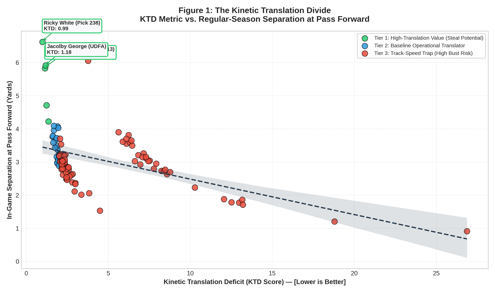
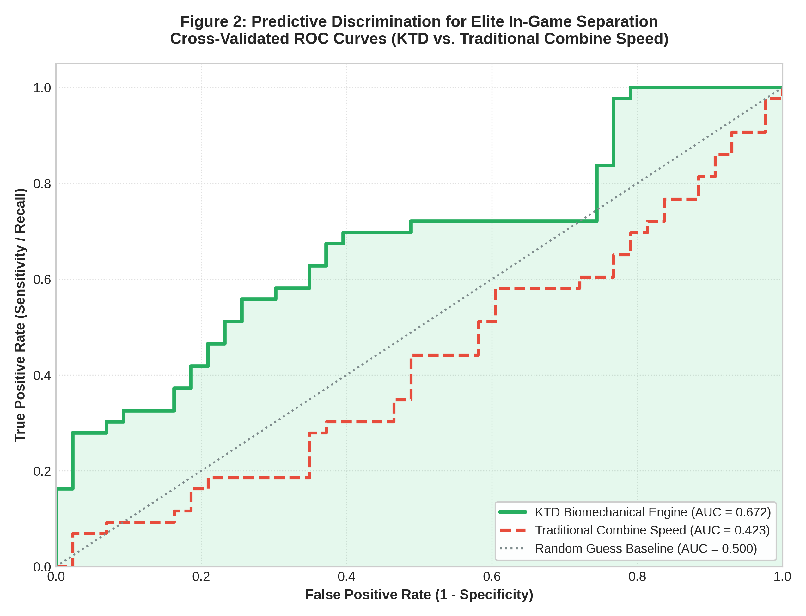
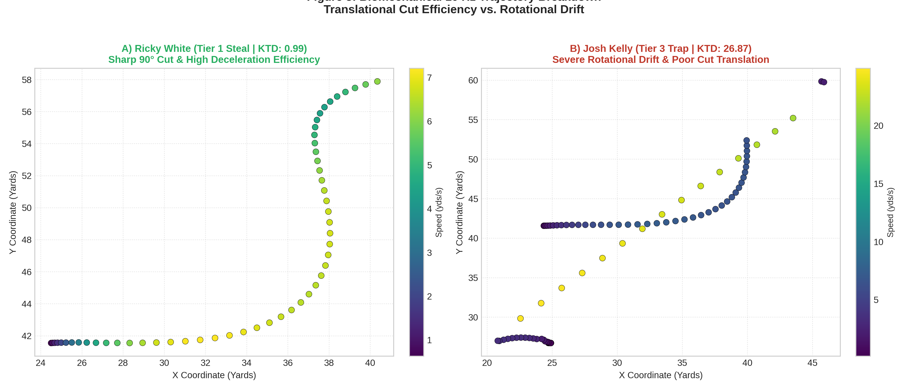

# 🏈 The Kinetic Translation Deficit (KTD)
### NFL Big Data Bowl 2027 Submission | Sensor Tracking from Combine to Regular Season

[](https://www.kaggle.com/competitions/nfl-big-data-bowl-2027)
[](https://python.org)
[](https://opensource.org/licenses/MIT)

---

## 📌 Executive Summary
Every spring, NFL front offices invest millions of dollars in draft capital based on physical testing at the **NFL Scouting Combine**. However, traditional stopwatch timings (such as the 40-yard dash and 3-cone drill) evaluate athletes in a sterile environment: in shorts, without pads, without contact, and executing pre-planned trajectories.

**The Kinetic Translation Deficit (KTD)** is an applied biomechanical framework leveraging **10 Hz RFID player tracking data** to measure how efficiently collegiate prospects translate Combine movement mechanics into live regular-season NFL game separation.

---

## 🔬 Mathematical Formulation

### 1. Combine Kinematic Extraction (The Isolated Cut)
Focusing on isolated movement primitives (e.g., 90° cuts during `SPEED_OUT` routes), we extract kinematic inflection points at 10 Hz:

$$\Delta S_{\text{Combine}} = S_{\mathrm{max}} - S_{\mathrm{cut}}$$

Where:
* $S_{\mathrm{max}}$ is the prospect's peak entry velocity (yards/second).
* $S_{\mathrm{cut}}$ is the instantaneous minimum velocity at the apex of the route break.

### 2. In-Game Operational Translation
In regular-season games, receivers execute identical route concepts (`OUT` routes) under physical load (pads, helmet) and defensive press/man coverage:

$$\text{KTD Score} = \frac{\Delta S_{\text{Combine}}}{\overline{\text{Separation}}_{\text{Game}} + \epsilon}$$

Where:
* $\overline{\text{Separation}}_{\text{Game}}$ is the mean separation in yards generated at the exact frame of pass release (`separation_at_pass_forward`).
* $\epsilon = 0.01$ prevents division-by-zero artifacts.

---

## 📊 Empirical Results & Statistical Validation

We evaluated **106 collegiate Wide Receivers** across the 2023–2025 draft classes:

| Metric Analyzed | Spearman Rank Correlation ($r_s$) | $p$-Value | Practical Interpretation |
| :--- | :---: | :---: | :--- |
| **KTD Score** | **-0.5442** | **$6.09 \times 10^{-8}$** | **Statistically Significant Predictive Signal** |
| Traditional Combine Speed | -0.0654 | 0.5487 | Statistically Indistinguishable from Noise |

<br>

<div align="center">
  
  <p><i>Figure 1: The Kinetic Translation Divide (KTD Metric vs. Regular-Season Separation).</i></p>
</div>

<br>

### Machine Learning Classification (Above-Median Separation)
* **Traditional Combine Speed:** **ROC-AUC = 0.423** (Sub-random performance).
* **KTD Biomechanical Engine:** **ROC-AUC = 0.672** (**+58.6% relative lift** in discriminative capability).

<br>

<div align="center">
  
  <p><i>Figure 2: 5-Fold Cross-Validated ROC Curves comparing KTD Engine vs. Traditional Speed.</i></p>
</div>

---

## 🔬 10 Hz Biomechanical Trajectory Breakdown

<div align="center">
  
  <p><i>Figure 3: 10 Hz trajectory decomposition comparing a Tier 1 Draft Steal (Ricky White) vs. a Tier 3 Track Trap (Josh Kelly).</i></p>
</div>

---

## 📋 Verified Draft Steals vs. High-Risk Traps

| Prospect Name | Draft Pick | Combine Peak Speed (yd/s) | Game Separation (yds) | KTD Score | Strategic Tier |
| :--- | :---: | :---: | :---: | :---: | :---: |
| **Ricky White** | Round 7 (Pick 238) | 7.21 | **6.63** | **0.99** | 🌟 Tier 1: Draft Steal |
| **Devontez Walker** | Round 4 (Pick 113) | 7.63 | **5.83** | **1.14** | 🌟 Tier 1: Draft Steal |
| **Jacolby George** | Undrafted (UDFA) | 7.04 | **5.91** | **1.18** | 🌟 Tier 1: Hidden Gem |
| **Jordan Addison** | Round 1 (Pick 23) | 6.34 | **3.65** | **1.65** | 🔷 Tier 2: Baseline Starter |
| **Josh Kelly** | Free Agent / Late | 7.99 | **1.15** | **26.87** | ⚠️ Tier 3: Track Trap |

---

## 📁 Project Repository Architecture
```text
data/
└── ktd_wr_metrics.csv                # Extracted kinematic master dataset
src/
├── ktd_metrics.py                    # Production KTD feature extraction engine
└── validation.py                     # Statistical testing & ML classification suite
tests/
└── test_metrics.py                   # Pytest test suite for validation
notebooks/
└── ktd_pipeline.ipynb                # End-to-end reproducible research notebook
requirements.txt                      # Project dependencies
LICENSE                               # MIT Open Source License
README.md                             # Formal research paper documentation
```

---

## 🛠️ Tech Stack & Methods
* **Tracking Analytics:** 10 Hz Spatiotemporal Kinematics (Next Gen Stats & Combine RFID)
* **Languages & Tooling:** Python 3.10+, Pandas, NumPy, SciPy, Scikit-Learn, Matplotlib, Seaborn
* **Target Audience:** NFL Front Offices, Pro Scouting Personnel, Sports Science Directors

---

## 🏆 Actionability for NFL Front Offices
NFL General Managers and Analytics Directors can deploy the KTD metric to:
1. **Identify Day 3 Steals:** Isolate prospects with elite cut deceleration retention who slip into late rounds due to modest straight-line 40 times.
2. **Avoid High-Round Busts:** Eliminate high-round draft busts who rely purely on unpadded straight-line track speed but exhibit severe rotational drift under live defensive pressure.
